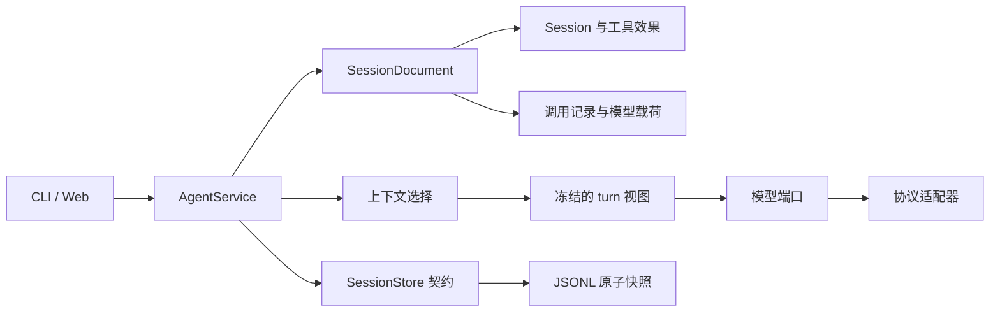

# 以持久化记录恢复会话

这是已审阅设计与实现取舍的记录。实现位于领域会话、应用会话文档和具体适配器中。配套的 [类型草图](durable-sessions-sketch.rs) 是设计阶段材料，不属于 COLA 编译模块；公共接口以源码与 `docs/` API 文档为准。最终运行证据另见 [实施验证报告](implementation-validation.md)。

## 问题与目标

CLI 与 Web 的新 turn 应当从硬盘上的已提交记录构造。清空服务内存、重建服务，不能使同一份已提交历史变得不可接续。当前 JSONL 只保存领域会话，原生响应和 ID 对应关系留在内存 `Continuation` 中，因此恢复带工具调用历史的会话会在 HTTP 之前失败。

采用用户提出的两条原则。持久化记录保存已观察且已提交的会话事实、模型调用和执行证据。模型输入是它的有意投影。历史使用的模型、usage 和耗时通常只用于审计，不能因为被持久化就自动进入 prompt。

“完整”有一个物理边界。进程在收到响应后、提交响应前崩溃，硬盘可能只有请求记录。此时必须记录响应未知，不能承诺保存尚未提交的内容。认证配置和请求认证头不属于会话归档。

## 调用方用法

CLI 和 Web 继续调用同一个应用用例。调用方不接触 continuation、原生响应块或持久化步骤。

```rust
let session = service.new_session()?;
service.chat(session.id(), user("读取文件并解释"))?;

// 另一个服务实例只依赖相同的 store 与显式配置。
reopened.chat(session.id(), user("继续刚才的问题"))?;

// 历史工具效果使用明确地址。
service.resolve_effect(call_address, resolution)?;

// reviewer 基础设施故障的阻断通过明确的审计动作解除。
// 解除不执行工具、不重试模型，也不声称未知效果已解决。
service.acknowledge_review_failure(session.id(), invocation_id, evidence, None)?;
```

`chat` 隐藏读取、恢复、选择上下文、模型调用、审核、执行和提交。检查会话与审计记录是读取用例，不触发恢复写入。

## 推荐结构

选择扩展现有原子快照的应用会话文档。一个 `SessionDocument` 同时保存领域 `Session`、逐次模型调用记录、冻结的 turn 输入视图，以及明确的故障确认记录。JSONL 是完整文档的磁盘表示，不改成事件日志。

领域层拥有会话状态、工具调用、执行事实和效果裁定。应用层拥有调用来源、模型调用生命周期、上下文选择、持久化契约和工作流。模型适配器拥有协议编码、原生块校验、HTTP 与响应捕获。JSONL 适配器拥有文件格式、排他锁和原子替换。领域层不引入 provider JSON、HTTP 类型或存储序列化。



`SessionDocument` 的变更方法检查关联和状态，调用方不能绕过它拼出一个“看起来合法”的文档。一个模型调用操作隐藏编码、协议检查、提交请求检查点、发送和捕获。接受结果的应用事务将领域输出、原始响应证据和调用来源一起提交。

应用的变更方法是 crate 内可见，文档字段不对外开放。writer 校验会话身份、关联完整性和 `next.revision = current.revision + 1`。外部调用方不能用任意完整文档覆盖会话。

### 原生 ID 与内部地址

保留 `ToolCallId = native-read`。磁盘上的原生响应和回传给模型的工具结果继续使用 `native-read`。删除随机 UUID 替换与双向映射。

内部使用 `CallAddress { session, turn, step, native }` 定位执行、审核、回执与效果裁定。这个地址表达作用域，不是另一份工具 ID。只有裸字符串无法表达调用属于哪一轮、哪一步，也无法拒绝较早执行留下的回执。

采用下列校验规则。

- 同一个响应批次出现重复 ID，保存拒绝原因和原始响应，不执行调用。
- 不同 step 或不同 turn 可以保存相同原生 ID，执行事实由完整地址区分。领域层不施加跨 step 的 provider 专用限制。
- 模型适配器在接受候选响应及构建请求时检查目标服务的额外约束。DeepSeek 已实测拒绝请求内重复 call_id；百炼的隔离对照接受了重复 call_id，但拒绝重复原生输出项 id。通用兼容实现可以采用保守限制，但不能把它冒充所有 provider 的领域规则。
- 旧回执不能通过相同的裸 ID 写到新执行上。
- `resolve_effect` 直接定位指定 step，保留当前相同裁定幂等、冲突裁定拒绝的语义。

领域层保留批次内唯一性，使一个 step 中的调用定位明确。跨 step 的执行结果、效果通知和效果裁定都携带完整地址，不能在恢复或投影时丢掉 step。请求级校验属于适配器，必须区分 call_id 和原生输出项 id。百炼接受一个请求并不证明任意重复关联在复杂任务中都正确，严格兼容策略仍需明确标记。完整地址使调用方和存储的关联明确，并消除对整个会话扫描裸 ID 的依赖。

### 逐次模型调用记录

记录单位是 invocation，不是 turn。一个 turn 可能包含多次 assistant 生成和多次 reviewer 生成，它们可能使用不同模型，也可能失败。

每次调用保存以下内容。

- invocation 序号、角色、目标 turn 与 step，reviewer 还关联准确的调用地址。
- 请求模型与实际返回模型。上游没有返回后者时保留未知，不用请求值冒充。
- 非敏感路由标识、effort、输出限制、策略和渲染器版本。
- 选择了哪些持久化记录，以及实际发送的模型请求正文。精确请求正文使后续渲染器升级不影响历史审计。
- 可获得的响应 ID、状态、usage、时间，以及响应正文和协议原生块。
- 完成、拒绝、输出不完整、传输错误、协议错误、领域拒绝等结果。被拒绝的响应不能产生可执行步骤。
- 数据未返回、超过既有捕获上限或响应未完整接收时，明确标记缺失情况。

模型载荷通过应用定义的不透明 `ModelArtifact` 保存。协议适配器负责解释其格式和版本。鉴权配置与认证头从捕获入口排除。面向 API 的错误仍使用安全诊断，不将归档的响应正文自动展示给调用方。

### 持久化与写入所有权

同一个会话的写用例先取得 OS 排他文件锁，持有到本次同步用例结束。另一个 CLI 或 Web 写者收到 `session_busy`。锁文件保持稳定，不通过删除锁文件“释放锁”。revision 用于校验提交顺序，不代替互斥。

每个用例在锁内读取最新完整文档。`acquire` 在返回可写文档前同步当前文件与目录，失败返回 `Storage`，不开始模型或工具 I/O。不存在覆盖磁盘记录的驻留 `Entry`。实现初版删除会话缓存。未来缓存只有在对应已提交 revision 且可随时丢弃时才允许使用。

读取原始文档不运行当前 `Session::restore` 的崩溃关闭逻辑。恢复是取得写锁后的明确应用变更，提交后才能开始新工作。读取列表或审计记录不修改会话，也不把仍由活跃写者拥有的 turn 宣告为进程丢失。

保持现有临时文件、文件同步、原子替换、目录同步的发布方式。提交成功才更新本次工作副本。替换前失败保留旧记录。替换后同步失败返回 `PublishedDurabilityUncertain`，立即终止当前用例，不继续外部 I/O。下一写者必须重新读取并完成同步和保守恢复，不能沿用失败调用的内存副本，也不能把错误当成回滚证明。

不增加另一个“权威状态文件”，也不试图在保存本身失败时再可靠保存一个 `StorageUncertain` 标志。提交错误使当前 writer 失效。

### 模型调用与工具执行检查点

1. 提交 invocation 的 `Planned` 记录。
2. 适配器构造和校验请求，通过应用 recorder 提交 `Prepared`，获得提交凭证后才允许发送。
3. 捕获结果。应用一次提交响应证据、来源和语义结果。assistant 输出通过领域接受后才产生 step。失败和 reviewer 响应同样保留记录。
4. 在任何审核与目标工具 I/O 前保存相应检查点。审核允许结果必须已提交，才可执行目标工具。
5. 保存工具结果后，才进行下一次模型调用。

端口不额外暴露公开的 `render`、`measure` 和 `send` 阶段。适配器内部的纯请求编译器调用应用选择计划的 `fit`，以完整编码后请求的字节长度作为度量。第一条 assistant 请求产生 `PreparedInvocation { request, Create(TurnView) }`，应用将实际选择、冻结前缀与 `Prepared` 一次提交。后续请求使用 `Reuse`，reviewer 使用独立语义输入。任何 `Prepared` 提交错误，包括替换后持久性未知，都不产生发送凭证。

用户消息和 `Planned` 先提交。若初始选择或协议准备失败，模型端口返回不含响应正文的准备失败观察，应用提交该 invocation 的明确原因，并将 turn 关闭为失败，不留下 active turn，也不发请求。成功响应被领域拒绝时，`accept_assistant` 返回带 `OutputRejected` 和原始响应的下一文档。方法的 `Err` 保留给非法应用状态、陈旧地址或不匹配证据。

保留当前崩溃关闭策略。新写者将遗留 active turn 关闭为 `Interrupted(ProcessLost)`，不会自动继续它。已提交的 `Prepared` 只能证明发送意图，不能证明请求已到达上游。恢复将未完成 invocation 标成响应未知。只有 `Planned` 而没有 `Prepared` 的调用可以明确标成未发送。

工具的 `Started` 仍不证明执行完成。未知效果、未执行调用和已确认结果继续通过现有领域通知表达，不伪造工具返回，不自动重跑工具。此次方案不采纳根据新增审核记录自动裁定 `NotPerformed` 的行为变更。

reviewer 无法产生有效审核结论时仍阻断会话。`Refused`、`Incomplete`、`Failed`、`OutputRejected`、准备失败和已准备却丢失响应的 reviewer invocation 都属于阻断原因。有效 `Decision(false)` 是拒绝执行，不阻断。

reviewer 只有 `Planned` 而没有 `Prepared` 就崩溃时，恢复记录 `ProcessLostNotSent`，不新增 reviewer 阻断。原 active turn 仍以 `ProcessLost` 关闭，其中既有调度意图与未知效果不因此被清除。这与已发生并提交的审核故障不同。

阻断由已提交调用与故障确认记录推导。新增 `acknowledge_review_failure` 确认后，如果对应 turn 仍 active，将它以原 reviewer 失败原因关闭为失败；若已因 `ProcessLost` 关闭，不改写原结局。确认、关闭与解除阻断同一次提交。时间和可获得的操作者标识随记录保存，没有身份信息时明确留空。相同 invocation 和相同确认重复提交幂等，不同确认冲突。

操作者标识通过应用方法的可选 `actor` 参数提供，表示调用方声明的审计来源。现有 CLI 与无身份机制的 Web 入口传 `None`，不编造身份。

当前 `Started` 包含审核前的调度意图。本方案保持这个含义。确认不会把它改回 `NotStarted`，也不会自动加一个 `NotPerformed` 裁定。原来的未知效果保持未知，未开始的调用保持未开始。确认不执行工具、不重试模型。重启不再暗中清除阻断。

新增 CLI 命令为 `/ack-review-failure <invocation_id> <evidence>`，作用于选中的会话。新增 Web 入口为 `POST /sessions/{session_id}/review-failure-acknowledgements`，JSON 为 `invocation_id` 与非空 `evidence`。成功或相同确认重试返回 200，冲突或非待确认调用返回 409，输入错误返回 400。阻断错误携带 invocation ID，方便调用方准确确认。这些接口已在实施阶段加入，详见 `docs/api.md`。

### 上下文是派生视图

模型输入分别处理语义内容与原生协议依赖。审计字段没有默认进入模型输入的通路。

初版使用可替换的 `ContextPolicy`，默认保留最近八个可选完整 closed turn，并额外强制保留包含尚未裁定效果的历史 turn。强制 turn 不占八轮名额，去重后计入正文预算。当前 turn 完整保留。选取已有完整 exchange，沿用其 `ExecutionNotice`，不重新从消息拼一个缺少效果证据的历史。

在 turn 开始时，初始请求采用可配置的 64 KiB UTF-8 正文上限，计入 system、tools、历史、当前输入和设置组成的整个 JSON 请求正文。先去掉最旧的可选完整 turn，再检查强制内容。强制内容超过上限时返回 `context_selection_too_large`。`InvalidSelection` 表示未知 turn、缺少强制 turn 或试图编辑当前 turn 的非法选择。不伪称字节策略错误是上游 token 容量耗尽。上限与八轮都是明确的初始策略参数，不是原型证明的最佳值，也不保证保留所有语义上重要的信息。已有 `Assistant` 与 `ToolCallReviewer` 扩展能力保留，任务特定的相关性策略在应用层替换默认策略。

reviewer 每次构建独立请求，适用同样的初始正文上限与可选历史删减规则。当前审核事实、准确候选和未知效果是强制内容。它不剪裁或更改 assistant 已冻结的视图。reviewer 请求放不下强制内容时记录准备失败并阻断，不能跳过审核执行工具。

历史的模型名称、usage、耗时和诊断不出现在语义历史正文。实际目标模型与原始来源仍可参与协议兼容性检查。reviewer 接收语义历史、当前活动事实和准确候选调用，不接收 assistant 的原生思考链。

所有 closed turn 都作为带来源与角色标签的历史数据呈现，包括用户、assistant、调用参数和已观察结果。工具输出保持外部数据的身份，不进入 system 指令。它们不作为当前协议的旧 `tool_use` 或 `function_call` 重放，因此跨 turn 的相同 ID 不引入原生关联冲突。历史数据的准确性与角色标记必须有请求快照校验。

每个新 turn 建立一个新的 provider 输入视图。选定的历史、system、tools 和模型设置冻结。该 turn 的后续工具循环仅追加其已接受原生输出和真实工具结果。请求前缀与依赖来自文档，不能从服务私有内存补齐。

对同一 active 链，按目标 provider 契约处理原生依赖。原生块在档案中完整保留。Anthropic 的绑定前缀包括 system、tools 和此前消息，不能只验证工具 ID。OpenAI 原生服务与兼容服务的 reasoning 规则需要区分。来源或前缀确实不兼容时返回明确协议错误，不静默编辑、丢弃或跨模型重放。不能只凭 `openai-responses` 就假定所有服务有相同的签名与加密状态语义。

新 turn 故意从语义历史重新建立原生视图，不携带前面 turn 的原生思考块。这是支持选择历史与切换 provider 的策略取舍，不是声称协议永远不需要跨 turn 原生状态。原始块仍完整归档。模型、provider 与配置变更在下一 turn 生效。进程恢复先关闭旧 active turn，因此此次修复不需要跨进程续接未完成的签名链。

后续真实模型切换原型已在同一个 JSONL 会话完成 deepseek-flash、qwen3.8-max、qwen3.8-flash、deepseek-flash、qwen3.8-max 五轮序列。八个新请求进程全部成功，新模型既使用了旧事实，也执行了本轮新工具。此证据支持已完成 turn 边界的新视图策略，不代表同一工具链中途可热切模型，详情见 [百炼与模型切换验证](bailian-live-validation.md)。

初始字节策略不在 turn 中途裁剪原生依赖。链增长仍受迭代和输出上限约束。上游真实容量错误作为调用结果归档，不能通过伪造或截断工具结果继续。准确 token 预算和回答质量优化属于后续策略评估，不能由此处协议原型证明。

## 候选比较与综合决定

四个独立候选使用 GPT-6.1 Sol、GPT-6 Astra、Claude Opus 5.5 与 Claude Sonnet 5.5。两个选择完整文档，两个选择事件日志。独立 cross-judge 使用 Claude Opus 5.5，建议以 Sol 文档方案为基础。父 agent 逐份读完并同意该结构选择。

| 结构 | 可取之处 | 本次取舍 |
| --- | --- | --- |
| 应用完整文档与原子替换 | 接受输出与证据同一次提交，复用已有存储机制 | 采用。接受归档增长与重复写入的成本 |
| 追加事件日志与派生 Session | 表达逐次事实和提交边界 | 不采用。新增重放、尾部恢复、事务去重和格式演进规则，当前没有测量证明需要 |
| 直接序列化累计 Replay | 接近现有代码 | 不采用。保留全历史耦合，也没有完整 invocation 审计 |
| 远端 provider 会话为权威 | 上游管理原生状态 | 不采用。无法满足硬盘可独立恢复的要求 |

从 Astra 采用接受响应时、执行之前的 ID 冲突校验。从 Opus 采用明确提交恢复与冻结 turn 计划的结构。从 Sol 保留完整请求证据和集中的应用事务。拒绝候选中的跨进程自动恢复 active turn、历史 ID 别名、digest-only 请求审计和额外事务标记文件。

后续百炼实测修订了 ID 约束的归属。批次内唯一性属于领域；跨 step、整条请求的限制归模型适配器。原先候选的 turn 内一律唯一规则不再作为通用领域约束。完整地址与接口形状保留，实施阶段据此修订了领域与适配器的校验归属。

按 Model the Domain，调用地址与 invocation 状态进入明确类型。按 Foundational Thinking，先确定聚合和原子接受边界。按 Exhaust the Design Space，比较两种完整存储结构。按 Fix Root Causes，删除内存 continuation 的正确性依赖。按 Prove It Works，分别报告真实领域 API 观察、独立进程数据实验与未验证的上游行为。

## 原型证据与边界

可运行原型与原始输出保存在 `.audit/durable-session/prototype/`。它们是可丢弃实验，不是已实现修复。

| 问题 | 实验与观察 | 证明边界 |
| --- | --- | --- |
| 原生 ID 可否直接套用当前约束 | Rust 调用真实 Session，跨 turn 重复 `native-read` 被拒绝 | 证明当前全会话约束需要改变 |
| 作用域能否区分旧回执与历史裁定 | Rust 的独立小状态机执行跨 turn 接受、旧回执拒绝与历史裁定 | 证明候选状态结构可表达该行为，不代表新领域实现已通过 |
| 持久化字段能否不进入 prompt | 文件经独立进程恢复，两个协议形状保留原生块与 ID，审计模型名称未进入正文 | 证明实验的数据流，不代表生产请求或 LLM 质量 |
| 缺失或编辑原生依赖怎么办 | 删除原生块，编辑 system、tools 或此前消息，夹具在发送前拒绝 | 本地契约检查，未验证真实签名 |
| 能否选择历史同时保留未知效果 | 真实 `Context` API 成功省略普通旧 turn，同时保留 unknown-effect 通知且无伪造返回 | 当前领域投影能力的运行证据 |
| 两个进程同时写同一会话怎么办 | Rust `File::try_lock`，第二进程收到 busy，杀死持锁进程后再次成功获得锁 | 当前 macOS 本地文件系统实测，不推断网络文件系统 |
| 保存报错是否等于回滚 | 在原子替换前后注入异常，分别观察旧 revision 与新 revision | 普通异常注入，不是掉电或全部 fsync 故障测试 |
| 两种存储都能表达事实吗 | 快照与事件 fold 得到相同示例状态，日志展示重放去重和尾部解析需求 | 表示方式实验，未实现完整存储适配器 |

生产实现仍需针对 CLI、Web、两种模型适配器与真实 JSONL 做集成验证。未经真实 provider 调用验证的签名和响应接受行为没有被计作已证明。语义投影的回答质量没有评估。后续 [DeepSeek 真实验证](deepseek-live-validation.md) 已证明本次工具往返、磁盘重建和语义历史请求形状被 DeepSeek 接受，仍不构成完整业务修复或回答质量证明。

## 分步实现计划

1. 定义调用地址、逐次 invocation 与 `SessionDocument`。调整会话、上下文、工具回执、效果通知和效果裁定的 ID 作用域。领域校验批次内唯一性，适配器在执行前校验目标服务的原生请求约束。
2. 替换存储契约和 JSONL 格式，加入排他 writer、精确读取与明确恢复提交。验证单文档关联、损坏拒绝、替换前后失败和锁争用。
3. 替换模型端口，捕获真实请求与响应，移除 `Continuation`、累计 `Replay`、UUID 映射和无条件历史拒绝。验证 reasoning 原样保留、前缀绑定、请求与实际返回模型、所有非成功结果归档。
4. 接入冻结的上下文选择与语义历史呈现。验证已选内容、被排除的审计字段、mandatory notices、初始选择超限和 turn 内依赖完整性。
5. 改造 `AgentService` 为 store 驱动，提交接受结果和审核结果后才允许执行。持久化 reviewer 故障与确认动作。CLI、Web 复用相同用例与明确错误分类。
6. 运行真实程序的完整对照。两种协议均覆盖重启接续、同进程切换、跨 turn 重复 ID、陈旧回执、多个模型 invocation、reviewer 失败、部分工具执行和进程丢失。移除旧限制测试，更新公开文档。

新格式直接使用版本 2，不做 v1 兼容或迁移。旧对话按用户授权在实现交付时一次性清理，不将“启动自动删除旧数据”放进库逻辑。当前阶段不执行删除。

## 验收条件

- CLI `/use` 后的新 turn 与 Web 首次加载会话均可从磁盘接续工具历史。
- 对同一已提交输入视图和配置，空内存与本次工作副本构造相同请求。进程崩溃的不同事实必须明确体现在恢复记录中。
- 每个接受的 assistant step 都有唯一 invocation 来源、实际可获得的响应证据和模型信息。reviewer 与失败尝试同样可查。
- 原生 ID 不经随机编号替换。跨 step 的领域事实可由完整地址区分；provider 不接受的原生关联在相关工具执行前拒绝并保留证据。
- 上下文有明确选择和原生依赖规则，审计字段不会顺带进入 prompt。
- 重启不会清除 reviewer 阻断，不会重复工具，不会把未知效果变成已完成。

## 风险与审阅点

完整请求和响应归档增加磁盘占用与快照重写量。此次没有性能测量，不据此宣称满足某个吞吐目标。先保留简单的一致性边界，实际规模要求变化时再测量是否改成日志或文档内部去重。

完整请求重复携带此前前缀，整个文档又在每次提交重写，因此总写入量可能超线性增长。这是为了不依赖旧渲染器也能审计实际请求而接受的成本。记录文档字节数、一次保存写入量和保存耗时，达到项目实际设定的磁盘或延迟预算时再比较文档内部去重与日志。此次没有证据支持固定的容量报警阈值。锁覆盖整个同步模型循环，其他写者可能长时间收到 busy，这是明确接受的串行交互成本。

每个 turn 使用新的语义视图会舍弃旧原生思考连续性。这换来有意选择历史与切换模型的能力。完整原始历史仍留在归档中，但不承诺相同回答质量。

默认最近八轮与 64 KiB 都是起始配置。它们不能替代任务相关性评估或精确 token 计量。新增故障确认用例是持久化 reviewer 阻断后的明确退出路径，应与其审计语义一起 review。

百炼文档还声明超出输入上限时可能自动截断，不能假设所有 provider 都会明确返回容量错误。适配器必须结合目标模型预算做发送前预检，无法完整容纳强制依赖时停止并记录明确原因。此处原有的初始字节上限不足以证明长工具链安全，需要在实现阶段完成预算策略与相关测试，不能依赖 silent truncation。此项来自文档，未用大输入探针实测。

故障确认不会消除审核前已有的 `Started` 调度意图，因此相关未知效果可能还需要单独的 `resolve_effect`。这是保持当前保守效果语义的代价。此次不以“审核没完成”自动改写执行事实。

未验证的外部行为仍包括 Anthropic 接受语义历史后开始新的 thinking 工具循环、OpenAI 官方服务在 `store:false` 下接受实际 encrypted reasoning 回传，以及历史工具数据的角色标记对模型行为的影响。用户提供的 DeepSeek 已完成真实工具往返、high reasoning 原生回传、语义历史新 turn 与单 JSONL 新进程重建验证，结果见 [真实验证报告](deepseek-live-validation.md)。DeepSeek 的成功不能替代其他 provider 验证；该探针中去掉 reasoning 也成功，不能据此声称保留或去除原生状态的质量等价。

后续 [百炼 qwen3.8-max 真实验证](bailian-live-validation.md) 也已完成工具往返、单 JSONL 新进程恢复、多步工具循环和语义历史探针，并观察到审核状态 incomplete 与 ID 校验差异。HTTP 200 必须结合生成状态、字段校验和实际输出解释。

## 证据来源

- 当前代码见 `src/domain/conversation.rs`、`src/domain/context.rs`、`src/app/agent_service.rs`、`src/app/model_client.rs` 和 `src/adapters/models/client.rs`。
- [PR 8](https://github.com/ShaoxinLi/COLA/pull/8) 明确将 durable replay 延后，[PR 12](https://github.com/ShaoxinLi/COLA/pull/12) 保留 memory-only continuation。没有查到必须使用双编号的历史论证，不将碰撞隔离的推测冒充作者动机。
- [OpenAI reasoning 文档](https://developers.openai.com/api/docs/guides/reasoning) 支持 stateless 原生推理材料回传并说明工具链相关依赖。
- [Anthropic thinking 文档](https://platform.claude.com/docs/en/build-with-claude/thinking) 说明签名块与前缀绑定，[tool call 文档](https://platform.claude.com/docs/en/agents-and-tools/tool-use/handle-tool-calls) 说明结果关联与消息顺序。来源于 2026-10-29 查阅。

## 实现协调记录

实现采用同一个应用文档与会话写锁，删除了内存 continuation 与权威会话缓存。新增 `src/app/session_document.rs` 拥有档案关联和变更，新增 `src/app/context_policy.rs` 拥有上下文选择与必须保留的审核事实。没有仅为缩短文件而拆出第二个领域会话模块。新增验证脚本属于开发验证工具，不进入运行时层间依赖。

有三项具体化与类型草图不同。

- step 使用经过边界和领域变更校验的一基 `u64`，没有单独新增 `StepId` 包装。零值、越界值和陈旧地址在使用与读取档案时被拒绝。
- recorder 返回不可由外部构造的 `SendPermit`，模型适配器取得它后才发送。它证明本次准备记录已经提交，不证明网络请求到达或上游响应已经落盘。
- 初版预算继续使用完整编码正文的字节上限，每次调用均检查，包括原生链增长与 reviewer。CLI/Web 配置也可调节预算。它没有自动查询模型窗口，也不声称精确 token 容量保证；调用方必须按目标模型选择上限。与原设计风险段提出的目标模型 token 预算相比，这是明确保留的限制。没有使用猜测的模型窗口默认值，也没有通过截断强制依赖处理超限。

故障注入覆盖提交前失败与已发布后返回错误两类边界。它证明应用后续 I/O 停止和重新取得文档后的恢复语义，不等同于真实断电试验。完整运行记录和最终审阅结论见实施验证报告。
